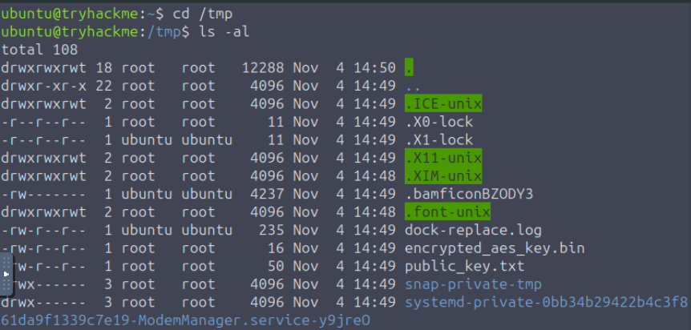
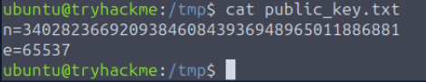
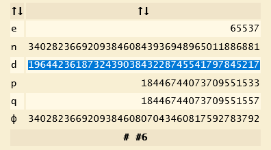
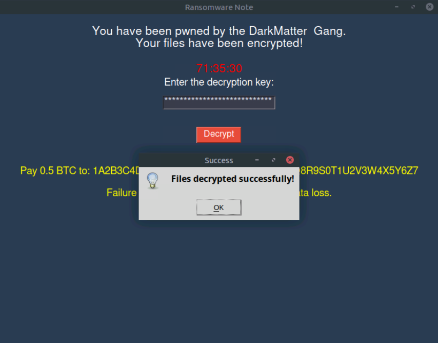

Разбор прохождения комнаты DarkMatter на платформе TryHackMe. Основная задача – расшифровать файлы, заблокированные программой-вымогателем, скомпрометировав слабую реализацию алгоритма RSA.

Из описания комнаты мы знаем, что вымогатель оставил отладочные данные в `/tmp`.    
    
Там находится текстовый файл `public_key.txt` с параметрами RSA.    
  
`n` = `340282366920938460843936948965011886881`  
`e` = `65537`  
> [!NOTE]
> Безопасность RSA зависит от сложности факторизации (разложение числа на простые множители). Число `n` в данном случае – 128-битный ключ. Ключи такой длины легко и быстро раскладываются современными вычислительными системами или онлайн-калькуляторами.

Для генерации приватного ключа (`d`) можем воспользоваться инструментом **RSA Cipher Calculator**.    
  
`d` = `196442361873243903843228745541797845217`

Теперь мы можем ввести значение `d` в поле ввода в интерфейсе программы-вымогателя.    
  
После этого мы получили доступ к файлу `student_grades.docx` на рабочем столе. Внутри этого файла находится флаг, необходимый для задания.

## Заключение

Решение задачи из этой комнаты позволило мне закрепить следующие знания и навыки:
* на реальном примере увидела зависимость надежности алгоритма RSA от длины ключа;
* практика в исследовании скомпрометированной системы: обнаружение отладочных файлов в `/tmp` показало важность проверки временных хранилищ при анализе инцидентов;
* восстановление секретного ключа (`d`) с помощью открытых параметров (`n`, `e`), что позволило обойти логику ВПО и расшифровать документ.
