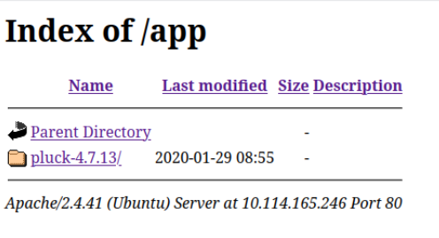
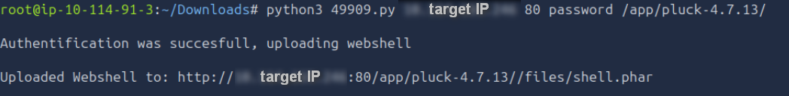
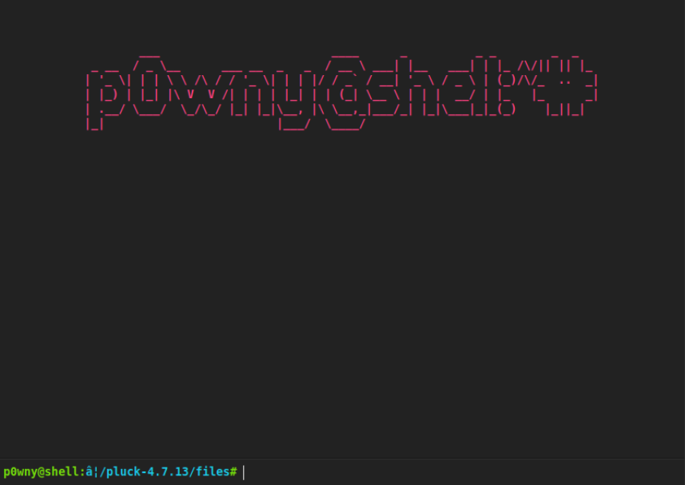

https://tryhackme.com/room/dreaming

## Первичный анализ
Переходим по адресу лабораторной машины, там нас встречает стандартное приветствие Apache.
Просканируем директории с помощью Gobuster.

  
   
  <em>Результат сканирования Gobuster</em>

Gobuster нашел директорию `/app`. При переходе туда замечаем интересную папку <b>pluck-4.7.13</b>.
 

  

А через нее можем попасть на страницу входа в админку.  

  

> [!NOTE]
> <b>Pluck</b> – это система управления контентом на PHP. Она не требует базы данных для работы. Версия <b>4.7.13</b> уязвима для удаленного выполнения кода ().
> Суть заключается в том, что в функции управления файлами нет должной проверки расширений загружаемых файлов.
> Имея права администратора мы можем обойти ограничения файла `.htaccess` и черный список расширений. Нам необходимо загрузить PHP-скрипт (`.phar`). Apache обработает его как исполняемый PHP-код. Это даст нам веб-оболочку для удаленного доступа к файловой системе на сервере.

На странице входа достаточно проверить несколько стандартных паролей, чтобы найти правильный – `password`.
Немного осмотревшись после успешной авторизации, находим тот самый уязвимый элемент Pluck – страницу загрузки файлов.
Теперь наша задача состоит в поиске подходящего эксплойта. Его можно найти на Exploit Database или Packet Storm.

  
   
  <em>Exploit Database</em>

Скачиваем эксплойт, корректируем его в соответствии с данными нашей целевой машины и запускаем скрипт.

  
   
  <em>Входные параметры из готового эксплойта с Exploit Database. Задаем IP-адрес цели, порт, пароль от учетной записи администратора и путь до Pluck CMS</em>

 

  
   
  <em>Подстановка параметров и результат работы эксплойта</em>

 

  
   
  <em>Web Shell на целевой машине</em>

