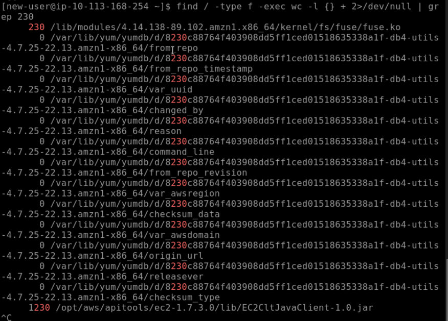
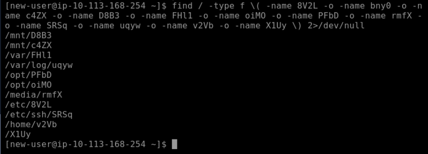
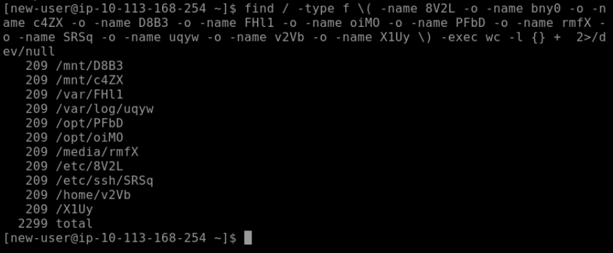
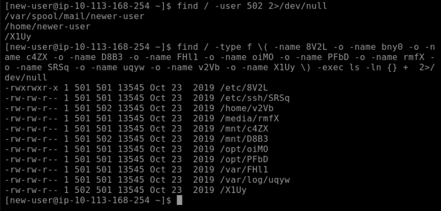

Разбор прохождения комнаты Ninja Skills на платформе TryHackMe. Она позволяет отточить навыки эффективной навигации и поиска данных в Linux-системах в условиях отсутствия прав суперпользователя.

Ответить на вопросы о файлах:
- 8V2L
- bny0
- c4ZX
- D8B3
- FHl1
- oiMO
- PFbD
- rmfX
- SRSq
- uqyw
- v2Vb
- X1Uy

Необходимо ответить на вопросы максимально эффективно.

Для поиска ответов на задачи из этой комнаты я использовала утилиту `find`. Она используется для поиска файлов в файловой системе и взаимодействует с **названиями** файлов, а не их содержимым, и выводит названия всех подходящих.  

Базовый синтаксис: `find [path] [options] [criteria] [actions]`  
* `path` указывает директорию, с которой начинается поиск (утилита работает и с вложенными директориями)
* `options` влияют на общую работу команды (например, глубина поиска); это не касается непосредственно фильтрации 
* `criteria` – это критерии поиска; каким условиям должен соответствовать файл
* `actions` передает, что сделать с найденным файлов (по умолчанию `-print`)
---
### #1 Какие из перечисленных выше файлов принадлежат группе `best-group`?
`find / -group best-group 2>/dev/null`

* `/` указывает начать поиск с корня всей системы, т.к. все файлы разбросаны по разным местам. _Если бы все файлы находились в одной директории, которая нам известна, эффективнее было перейти в нее и использовать `.` – поиск с текущей директории._  
* `-group` указывает искать по определенной группе.
---
### #2 Какой из файлов содержит IP-адрес?
`find / -type f -exec grep -lE '([0-9]{1,3}\.){3}[0-9]{1,3}' {} + 2>/dev/null`

* `-type f` ищет только файлы, пропуская директории  
* `exec <...> {} +` – конструкция, которая передает все найденные файлы как аргументы для следующей команды  
* `grep` ищет совпадения по **содержимому** файла  
* `-l` указывает выводить только **имена** найденных файлов, а не содержимое  
* `-E` включает расширенные регулярные выражения  
* `'([0-9]{1,3}\.){3}[0-9]{1,3}'` – шаблон регулярного выражения для поиска IP-адреса.  

В выводе будет довольно много совпадений. Можно написать команду, которая будет искать исключительно по именам, указанным в условии задания, но мне видится это менее эффективным, чем внимательно просмотреть вывод.

---
### #3 Какой файл имеет хеш SHA1 9d54da7584015647ba052173b84d45e8007eba94?

`find / -type f -exec sha1sum {} + 2>/dev/null | grep 9d54da758401`

* `sha1sum` высчитывает хэш SHA1 для каждого файла и выводит его вместе с путем к файлу  
* `|` – пайп – вывод предыдущей команды передает на вход следующей  
* `grep 9d54da758401` отсеивает все лишнее и оставляет только строку, которая содержит указанный фрагмент  
---
### #4 Какой файл содержит 230 строк?

По аналогии с предыдущими заданиями я хотела использовать `find / -type f -exec wc -l {} + 2>/dev/null | grep 230`, но я не получила ожидаемого вывода. 

  
Развернуть изображение

  
     
  

Здесь есть только один файл, содержащий 230 строк, и он не из того списка, который дали в условии. Поэтому я решила узнать, а где же вообще лежат все эти файлы? Возможно, к какому-то из них у меня нет доступа.  
Воспользовалась командой `find / -type f \( -name 8V2L -o -name bny0 -o -name c4ZX -o -name D8B3 -o -name FHl1 -o -name oiMO -o -name PFbD -o -name rmfX -o -name SRSq -o -name uqyw -o -name v2Vb -o -name X1Uy \) 2>/dev/null`.   

> [!NOTE]
> Экранирование скобок (`\(...\)`) необходимо для корректной обработки команды утилитой `find`. `(` `)` – спец. символы, которые оболочка обрабатывает по-своему.

  
И действительно, в списке только 11 файлов из 12.

  
  

Модифицировала команду для подсчета количества строк:  
`find / -type f \( -name 8V2L -o -name bny0 -o -name c4ZX -o -name D8B3 -o -name FHl1 -o -name oiMO -o -name PFbD -o -name rmfX -o -name SRSq -o -name uqyw -o -name v2Vb -o -name X1Uy \) -exec wc -l {} + 2>/dev/null`

* `wc -l` считает количество строк в каждом файле. _`wc` по умолчанию считает слова (word count), но с флагом `-l` (lines) указывает считать строки_

11 файлов и ни в одном нет 230 строк, методом исключения можно понять, какой необходим для ответа.

---
### #5 У какого из файлов идентификатор пользователя 502?

Для ответа на этот вопрос я решила воспользоваться двумя способами:

`find / -user 502 2>/dev/null`

* `-user 502` ищет файлы по UID

`find / -type f \( -name 8V2L -o -name bny0 -o -name c4ZX -o -name D8B3 -o -name FHl1 -o -name oiMO -o -name PFbD -o -name rmfX -o -name SRSq -o -name uqyw -o -name v2Vb -o -name X1Uy \) -exec ls -ln {} + 2>/dev/null`

* `ls -ln` выводит подробную информацию о файле (`-l`) и заменяет имя пользователя на ID (`-n`)

---
### #6 Какой файл может выполняться всеми пользователями?

В этом задании достаточно взглянуть на вывод из пятого вопроса.  
Первая команда в этом никак не помогла бы, и для этого задания в любом случае пришлось бы использовать поиск с фильтрации по именам файлов.

---
### 2>/dev/null
Эта конструкция используется для очищения вывода команд от сообщений об ошибках.  

В Linux у каждого процесса есть три потока данных:
- `0` (stdin) – стандартный ввод;
- `1` (stdout) – стандартный вывод;
- `2` (stderr) – стандартный вывод ошибок.

Если у нас нет root доступа, при поиске из корня системы мы столкнемся с огромным количеством ошибок _Permission denied_. `2>` означает перенаправление ошибок в другое место, а `/dev/null` – это виртуальный файл в Linux, который уничтожает любые записанные в него файлы.

---
### Заключение

Прохождение этой комнаты помогло мне закрепить навыки базового администрирования и разведки в Linux:
- **Работа с `find`:** Я глубоко разобралась в синтаксисе утилиты, научилась комбинировать гибкие критерии поиска (по группам, правам доступа, владельцам, типам объектов) и использовать логический оператор `-o` (OR) для точечной фильтрации.
- **Перенаправление потоков:** На практике освоила конструкцию `2>/dev/null`, осознав разницу между стандартным выводом (`stdout`) и выводом ошибок (`stderr`).
- **Конвейеры и автоматизация (`|`, `-exec`):** Научилась связывать утилиты в мощные цепочки, передавая результаты поиска напрямую в `grep`, `wc` и `sha1sum`.
- **Регулярные выражения (Regex):** Закрепила применение расширенных регулярных выражений (`grep -E`) для быстрого обнаружения специфических паттернов данных (таких как IP-адреса) внутри файлов.
