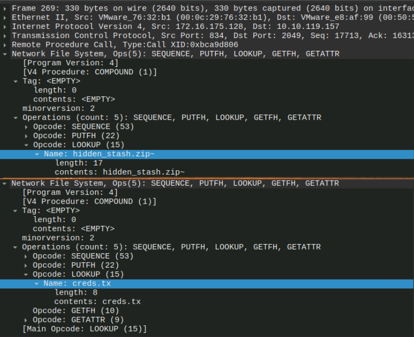
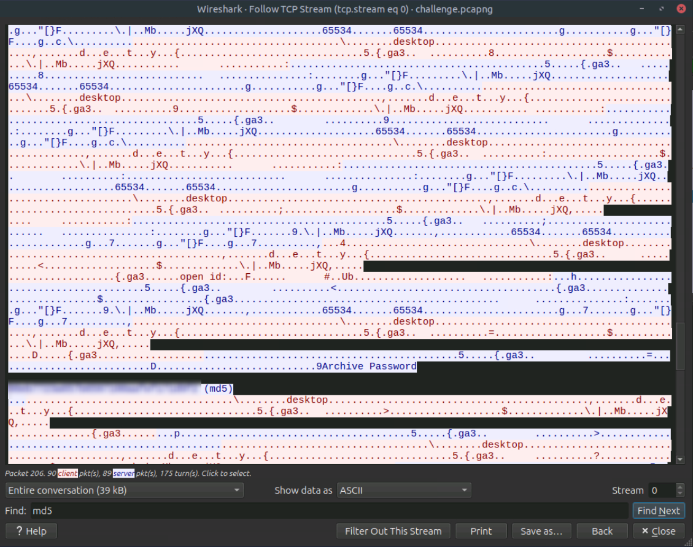
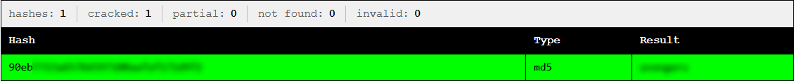
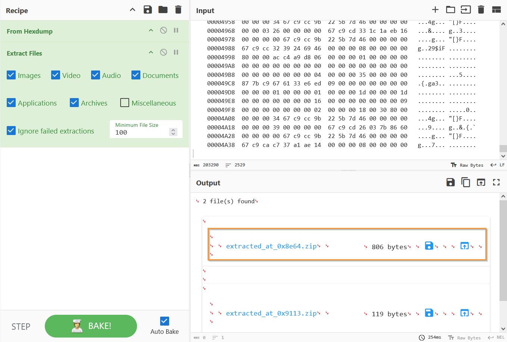
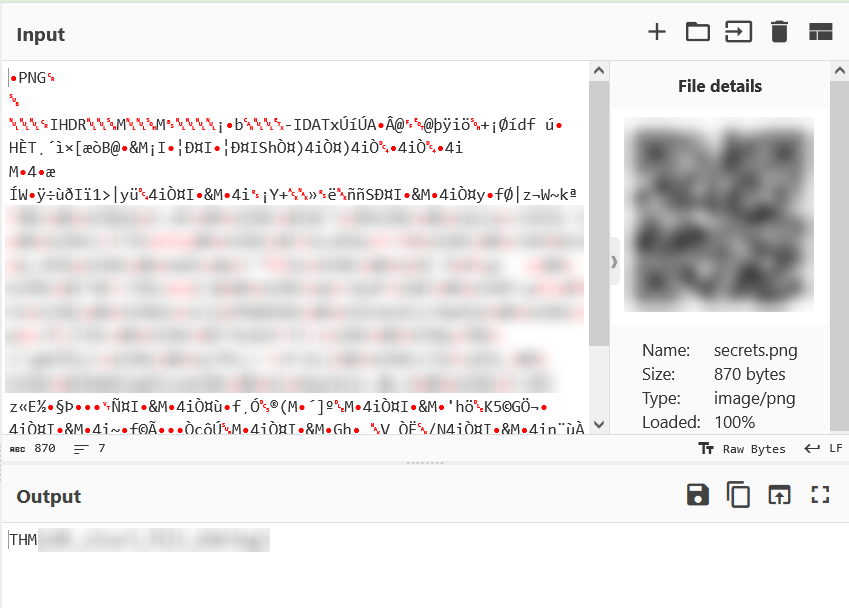

Write-up CTF Stolen Mount. 
Ссылка – https://tryhackme.com/room/hfb1stolenmount

В этой задаче было необходимо проанализировать сетевой трафик из файла захвата пакетов pcap. Трафик связан с атакой на NFS-сервер. Основная цель – извлечь содержимое украденных данных.

Открыла предоставленный pcap файл в Wireshark и отфильтровала `nfs` трафик.
Среди пакетов я искала те, в которых участвовала операция `LOOKUP`, т.к. именно в них клиент запрашивает у сервера доступ к определенному файлу по имени.
Просмотрев все подходящие пакеты я выделила два интересных. В одном клиент обращается к файлу `hidden_stash.zip`, во втором – к `creds.txt`.

> Небольшое уточнение: второй файл на скриншоте отображается как `creds.tx` в силу особенности разбиения трафика. Длина в этом пакете равна 8.

Поскольку это NFSv4, данные файла передаются не в этом же пакете (это был только запрос `LOOKUP`), а чуть дальше. Поэтому я отследила поток TCP, там нашла хэш MD5, расшифровала его и получила **пароль от архива**.

После этого я вернулась к пакету, в котором упоминался файл `hidden_stash.zip`, отследила поток данных, содержащий этот zip-архив. Бинарные данные в формате Hex Dump прогнала через CyberChef и получила архив.

Этот архив защищен паролем, который ранее я нашла в файле `creds.txt`.
В архиве содержится png файл с QR-кодом.

Декодировала QR-код с помощью того же CyberChef с опцией **Parse QR Code** и получила флаг.

